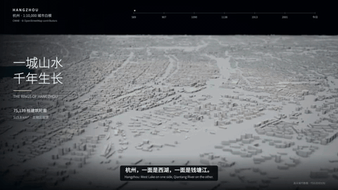
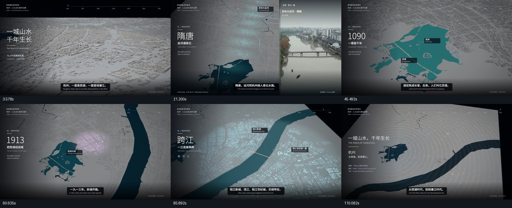
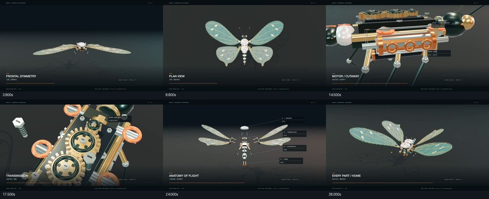
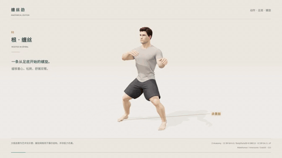
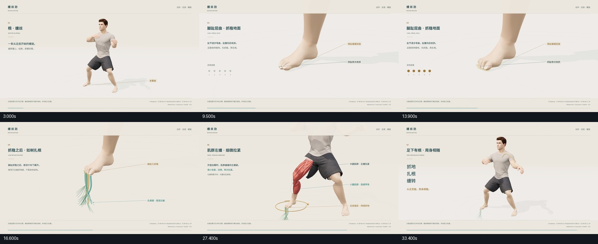
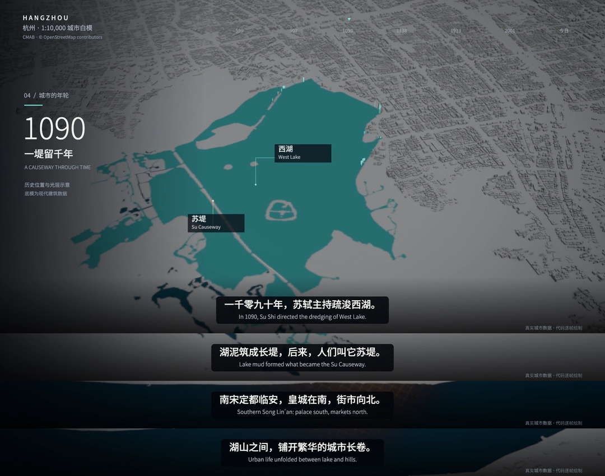
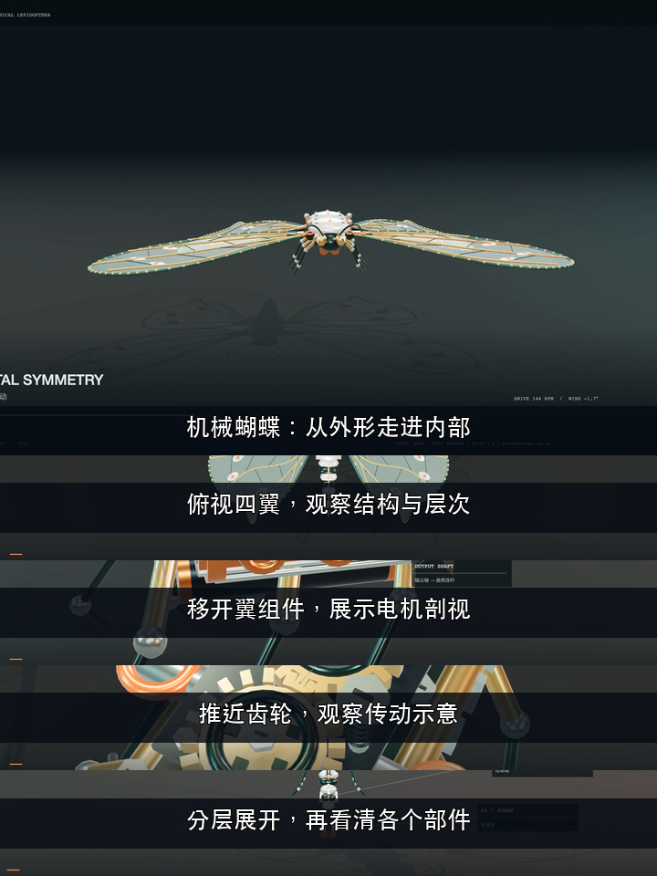

# videos-cut · 可复现的视频混剪工具链

[](LICENSE)

**把剧本、素材和声音变成短片、字幕图卡与代码动画，让制作过程可检查、可复用。**

面向开发者和 AI Agent 的本地 Python CLI：从网页导入素材，生成或保留旁白，精剪口播，合成字幕、图片运镜、转场、动态贴纸和配乐，也能从真实视频帧制作字幕图卡，或把 Canvas / Three.js 工程逐帧编码。用 JSON 描述作品，用命令组合工作流。

[快速开始](#快速开始) · [能力地图](docs/capabilities.md) · [使用指南](docs/usage.md) · [让 AI 来操作](docs/ai-guide.md) · [全部文档](docs/README.md)

| 层次 | 在项目里负责什么 |
| --- | --- |
| **通用工具** | 下载、转录、配音、剪辑、抽帧、图卡排版、代码出片与文件校验 |
| **场景技能** | 根据平台和内容组织工具，例如[小红书访谈字幕图文](skills/xiaohongshu-quotes/SKILL.md)的选题、选句、版式与文案 |
| **作品工程** | `films/` 保存杭州、机械蝴蝶、太极等具体作品的模型、数据、镜头和专用检查 |

宿主 Agent 负责理解、创作和看图，工具负责确定性执行；平台规则放在技能与模板中。[完整能力、边界与证据](docs/capabilities.md)集中维护。

## 先看成片

前三张 GIF 从项目交付的**实际编码视频**截取：每张将三段 2 秒画面接成 6 秒无声循环，咖啡样片为 5 秒预览，均保留真实画面比例。静态六帧总览可展开查看；来源、时间点、SHA-256 与许可见[展示媒体说明](docs/media/README.md)。

### 杭州城市片：数据白模、历史光层与实景辅助



<details>
<summary>查看六帧静态总览</summary>



</details>

**120 秒、1920×1080、24fps**。Three.js 主镜头约 82%，12 份实景各用一次，IndexTTS-2.5 参考音色解说；24 句字幕中点 OCR 与 9 处音轨波形抽查通过。该抽样检查不等于 Qwen 全帧门禁。[工程与复现](films/hangzhou/README.md)。

### 机械蝴蝶：多机位、机芯剖视与分层拆装


<details>
<summary>查看六帧静态总览</summary>



</details>

**32 秒、1920×1080、30fps，11 个镜头**。代码构建机械体并计算运动，经 codefilm 捕获 960 帧，配乐使用署名的《Neon》。这是机械概念动画。[电影版工程](films/mechanical-butterfly/CINEMATIC.md)。

### 太极图解：五趾抓地、生根比喻与肌群缠紧



<details>
<summary>查看六帧静态总览</summary>



</details>

**V3：36 秒、1920×1080、24fps，864 帧**。五趾先屈曲抓地，抓稳后才出现根须比喻；足部保留皮肤，发力时展示腿部外旋与肌群细微左缠、收紧和回弹。属于艺术与劲意图解，解剖衍生画面为 CC BY-SA 4.0，保留 Z-Anatomy / BodyParts3D / DBCLS 署名。[工程与许可](films/taiji-silk/README.md)。

### 视频变图文：保留原字幕，或绘制有来源的后期说明

| 原生字幕图卡：杭州原片连续四句 | 脚本图卡：机械动画后期说明 |
| --- | --- |
|  |  |

左图从原片裁切字幕，统一等比缩放；右图在真实帧上绘制本项目编写的说明，明确属于后期文字。它们用于展示通用图像工具，不冒充第三方访谈案例。[工具合同](docs/image-tools.md) · [小红书场景工作流](skills/xiaohongshu-quotes/SKILL.md)。

### 咖啡竖屏短片：素材、字幕、转场与贴纸

下面是项目实际生成的咖啡短片，展示图片运镜、素材切换、中文字幕与透明贴纸。


<details>
<summary>查看六帧静态总览</summary>


</details>

这版样片为 **41.108 秒、720×1280、24fps**，含 6 个镜头、12 句字幕、5 次转场和 6 个贴纸，使用 Edge TTS 配音。GIF 是其中 5 秒的无声预览；[来源、归属和生成说明](docs/media/README.md)随仓库保存。它展示基础合成效果；Qwen 字幕验收另有[实跑记录](docs/verification.md)。完整视频可按下方命令在本地生成。

## 基础通用能力

| 能力 | 实际产出 |
| --- | --- |
| **剧本 → 完整短片** | 按句配音、按标签选片、照片缓慢推近、7 种可选转场、字幕、浮动/缩放贴纸、配乐与响度处理 |
| **宿主 Agent 创作交接** | Agent 写稿/生图，本地 `prepare` 列出缺失素材、校验文件，输出可直接渲染的配置；无需另接写稿或生图 API |
| **已有录音 → 保留原声混剪** | 使用实际识别的字幕和句段安排镜头；不需要重新生成声音 |
| **口播精剪与素材穿插** | 按真实词时间删除指定口头词和长停顿，按视频帧同时切音画，重排字幕；`mix` 再交替使用原片和素材 |
| **本地语音转录** | 输出 TXT、SRT、逐词 JSON；长音频分段解码，完成段可缓存、恢复，损坏段单独重算 |
| **网页视频 / 音频导入** | yt-dlp 网页解析，以及微信视频号本地捕获/解密服务接入；清晰度选择、字幕轨、缓存和失败重试；输出可直接用于渲染的素材清单 |
| **参考音色与语音控制** | 默认使用 IndexTTS-2.5 生成新旁白；IndexTTS 支持原生语速、情绪向量与逐句拼音纠音 |
| **字幕显示与成片验收** | IndexTTS 默认用 Qwen 定位句末，上一句结束即显示下一句；固定分条、SRT 回读、全部编码帧及音轨偏移检查 |
| **42 个 FFmpeg 工具** | 改画幅、字幕烧录、音乐自动压低、HDR 转 SDR、多机位同步、平台导出、批处理与剪辑软件时间线导出 |
| **代码动画逐帧出片** | 本地 Canvas / Three.js 页面按 `render(t)` 绘制，支持分镜静帧、局部预览、分段续跑与实际编码文件完整性检查 |
| **抽帧、文字索引与字幕图卡** | `images` 提供候选帧、字幕区域预览、SRT/VTT/ASR 索引、原生/脚本排版、按内容续跑和实际图片校验；不包含平台选题规则 |

## 工具之上的场景技能

| 场景 | 提供的工作流 |
| --- | --- |
| [小红书字幕图文 Skill](skills/xiaohongshu-quotes/SKILL.md) | Agent 阅读访谈/讲解、提名主题、核对原句和说话人，组合通用工具生成主图与字幕条，逐图检查，按需整理发布文案 |
| [剧本短片 / 原声混剪](skills/video-workflow/SKILL.md) | 素材交接、旁白或 ASR、精剪、合成与成片检查 |
| [城市、机械和动作图解](skills/codefilm-workflow/SKILL.md) | 故事与数据、Three.js 分镜、确定性捕获、后期与作品专用验证 |

本项目工作流统一维护在 `skills/`，`docs/` 维护工具参数、配置和架构，`films/` 保存具体作品。第三方 [ffmpeg-skill](.agents/skills/ffmpeg-skill/SKILL.md) 通过 Git submodule 固定上游提交，直接引用其源码。完整清单与未实现边界见[能力地图](docs/capabilities.md)。

### 值得开发者关注的设计

- **时间轴来自声音。** 生成旁白按真实 PCM 采样数计算时长；已有录音用 ASR 词时间。换声音后重新计算镜头和字幕，避免按字数猜时长。
- **检查编码后的成片。** 语音对齐模式读取实际视频帧里的字幕并检查音轨偏移，通过后才将候选文件交付为 `final.mp4`；失败保留证据。普通文件字幕和 ASR 字幕会明确标记同步未验证。
- **每一步可追溯。** 素材来源、SHA-256、转录、删除区间、镜头时间轴、字幕计划和验收报告都能落盘；可校对转录后复用，也可复用已有配音与背景。
- **工具可以拆开用。** 下载、转录、精剪、混剪和 FFmpeg 后期各有入口，通过文件组合。主流程不需要接入付费大模型 API；语音模型依赖隔离在独立环境。

## 快速开始

需要 [uv](https://docs.astral.sh/uv/)、Python 3.12（主项目支持 `>=3.12,<3.14`）、系统 FFmpeg 和中文字体。以下是已验证的 macOS 路线，先递归克隆，再从仓库根目录执行命令：

```bash
# 克隆时带上固定的第三方技能。
git clone --recurse-submodules https://github.com/bindoon/videos-cut.git
cd videos-cut
# 已有工作区执行：git submodule update --init --recursive
brew install ffmpeg
uv sync
uv run videocut demo --tts macos --output outputs/coffee-local
```

语音合成默认使用 **IndexTTS-2.5**（`--tts indextts`），需提供 `--reference-audio`；先按 [IndexTTS 安装说明](docs/voice-controls.md#安装与下载) 和 [字幕对齐说明](docs/subtitle-sync.md) 准备模型。上面的快速检查显式使用 macOS 系统声音。默认输出 `720×1280 / 24fps`；macOS 系统 Tingting 配音在本地运行，首次仍需下载示例素材。使用在线 Edge 配音可显式选择 `--tts edge`。网络较慢时，先生成小尺寸预览：

```bash
uv run videocut demo --tts macos \
  --materials examples/materials-preview.json --width 480 --output outputs/preview
```

结果目录包含 `final.mp4`、`captions.srt`、`timeline.json`、`sources.json`、`verification.json`、`contact-sheet.jpg` 和配置快照。更换剧本、素材、声音以及各模式的附加产物见[使用指南](docs/usage.md)。

主链路实跑平台是 macOS Apple Silicon。IndexTTS 默认使用 MPS，可显式选择 CPU/CUDA；下载/ASR 文件锁依赖 macOS/Linux 的 `flock`。Linux 需准备中文字体并选择相应配音方案，原生 Windows 全流程尚未验证。

## 按任务使用

下载与 ASR 需要额外依赖；安装后按需选一个入口：

```bash
uv sync --extra download --extra asr

# 只转录：文字、SRT、逐词 JSON。
uv run videocut transcribe /absolute/path/input.mp4 --output outputs/transcribed

# 精剪：删长停顿与默认口头词，保留原声。
uv run videocut cut /absolute/path/talking.mp4 --output outputs/cleaned

# 精剪后混剪：原片与素材交替，叠字幕、贴纸和配乐。
uv run videocut mix /absolute/path/talking.mp4 --output outputs/mixed

# 自己的剧本和素材目录。
uv run videocut render --config examples/coffee.json \
  --materials examples/materials.json --tts edge --output outputs/my-video
```

下载视频链接、已有旁白、IndexTTS 安装及配置，参见[完整使用方法](docs/usage.md)。每次成片使用新的 `--output` 目录。

独立后期操作走项目内固定的 ffmpeg-skill，无需另装全局技能：

```bash
# macOS 扩展工具推荐完整滤镜构建。
brew install ffmpeg-full
uv run videocut ffmpeg --list
uv run videocut ffmpeg fit input.mp4 --aspect 9:16 --fit blur \
  -o outputs/vertical.mp4 --json-brief
```

具体参数、预演和平台导出见 [FFmpeg 工具说明](docs/ffmpeg-tools.md)。

通用图像处理使用独立入口，不需要配音或 ASR 模型：

```bash
uv run videocut images sample input.mp4 --at 12.5 --around 0.4 --output outputs/candidates-01
uv run videocut images plan --manifest task/cards.json
uv run videocut images render --manifest task/cards.json --output outputs/cards-01
uv run videocut images verify outputs/cards-01/image-report.json
```

输入合同、两种字幕来源、模板与增量续跑见[通用图像工具](docs/image-tools.md)；平台使用方法见[小红书字幕图文](skills/xiaohongshu-quotes/SKILL.md)。

城市白模、数据动画等代码画面使用独立的 `codefilm` 入口；需要 Node.js、影片内的 Playwright 和 Chromium。先用自带两秒示例检查环境：

```bash
npm ci --prefix examples/codefilm
# 使用 Playwright 默认 Chromium，或设置 PLAYWRIGHT_CHROME 指向已安装的可执行文件。
uv run videocut codefilm plan --config examples/codefilm/codefilm.json
uv run videocut codefilm render --config examples/codefilm/codefilm.json --output outputs/codefilm-demo
uv run videocut codefilm verify outputs/codefilm-demo/render-manifest.json
```

浏览器安装、配置与缓存见 [codefilm 工具指南](docs/code-films.md)，完整制作步骤见[代码影片技能](skills/codefilm-workflow/SKILL.md)；[杭州工程](films/hangzhou/README.md)保留实际的数据、叙事、配音和后期范例。该入口先输出无声画面分段，声音与交付通过文件衔接。

## 如何让 AI 使用

把项目路径、输入文件和目标告诉 AI，并让它先读 [AI 操作指南](docs/ai-guide.md) 和对应 `skills/*/SKILL.md`。例如：

> 请先阅读 AGENTS.md、docs/ai-guide.md 和 docs/usage.md。把 `/absolute/path/talking.mp4` 精剪后做成竖屏混剪，保留原声，去除长停顿和“嗯、呃”，搭配咖啡素材。先检查输入与素材配置，输出到新的目录；完成后检查实际画面和报告，给我成片、截图和删除记录。

指南提供可复制提示词与技能导航；[视频工作流技能](skills/video-workflow/SKILL.md)维护任务路由、缓存复用和交付检查，并区分下载字幕、ASR 时间与 Qwen 对齐记录。

从创意开始时，宿主 Agent 编写[创作计划](examples/creation-plan.json)，使用当前可用的生图工具补充素材，再通过 `videocut prepare --plan ... --output ...` 交给本地渲染。生成图片与发布文案不混入旁白；AI 视频需求单独列明，当前不自动提交外部生成服务。宿主生图可能联网或占用账户额度，具体流程见[使用指南](docs/usage.md#宿主-agent-创作与本地素材交接)。

## 站在这些开源项目之上

| 项目 | 吸收或使用的部分 |
| --- | --- |
| MoneyPrinterTurbo | 参考“脚本 → 配音 → 素材 → 字幕 → 合成”的编排与分层合成思路 |
| MoviePy / Pillow / FFmpeg | 实际执行画面图层、文字、贴纸、转场、音画裁切与编码 |
| faster-whisper / Auto-Editor | 逐词转录与独立静音粗剪；本项目负责缓存、精剪计划与字幕重排 |
| Qwen3-ForcedAligner | 给定原稿与音频，定位字词及句末；本项目补充固定展示计划与成片验收 |
| IndexTTS / Edge TTS | 默认参考音色、本地语音控制及在线配音 |
| yt-dlp | 网页视频、音轨、字幕和播放列表解析；本项目负责素材接入、校验与失败恢复 |
| ffmpeg-skill | Git submodule 固定引用 2.16.1 的 42 个工具、技能说明与模板，通过 CLI 直接调用 |
| native-subtitle-quote-image | 参考原生/脚本字幕区分、连续字幕条与候选帧复核；本地独立实现通用图像工具和场景技能 |

[开源来源与集成说明](docs/open-source.md)进一步区分了设计参考、依赖调用、随仓库分发的代码和历史实验，并记录固定版本与素材归属。

## 开发与验证

```bash
uv sync --extra download --extra asr
uv run pytest -q
```

确定性测试含真实本地 HTTP 服务与 FFmpeg；平台联网下载、实际语音模型与听感检查单独记录。[验证记录](docs/verification.md)保留各阶段结果，测试通过数和耗时属于对应运行环境。

继续阅读：[架构与数据流](docs/architecture.md) · [字幕同步](docs/subtitle-sync.md) · [声音克隆](docs/voice-cloning.md) · [IndexTTS 控制](docs/voice-controls.md)。

当前素材选择使用标签匹配；任意视频的视觉理解、交互式时间线、专门呼吸识别、完整 SSML 与自动发布尚未实现。扩展工具的高光候选按声能等指标排序，不等于理解内容；其平台检查也不替代本项目字幕同步验收。

仓库保存代码、示例、文档、锁文件和小型展示媒体；模型、缓存、上游工作区、虚拟环境和生成视频由 `.gitignore` 排除。未调用付费 API 的运行会记录 `paid_api_calls=0`，本机算力、流量和存储另有成本。

## 许可证

本项目原创代码、工作流技能和文档采用 [MIT License](LICENSE)。第三方代码保留上游许可证；模型、素材和展示媒体适用各自许可，详见[开源来源](docs/open-source.md)与[展示媒体归属](docs/media/README.md)。
